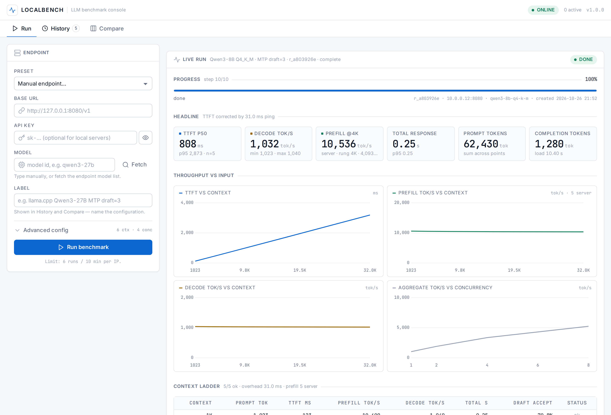
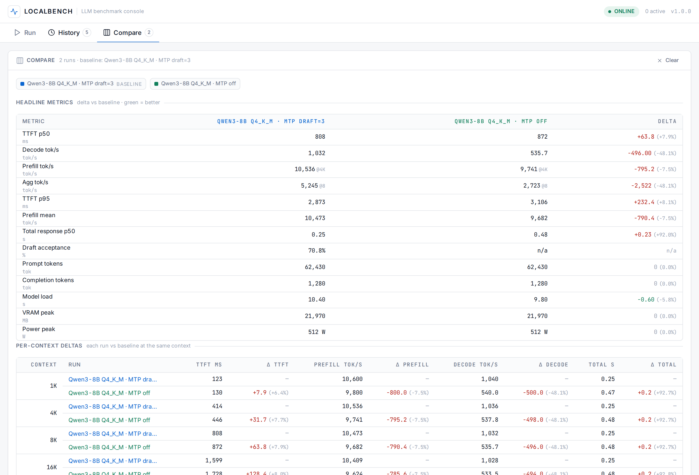
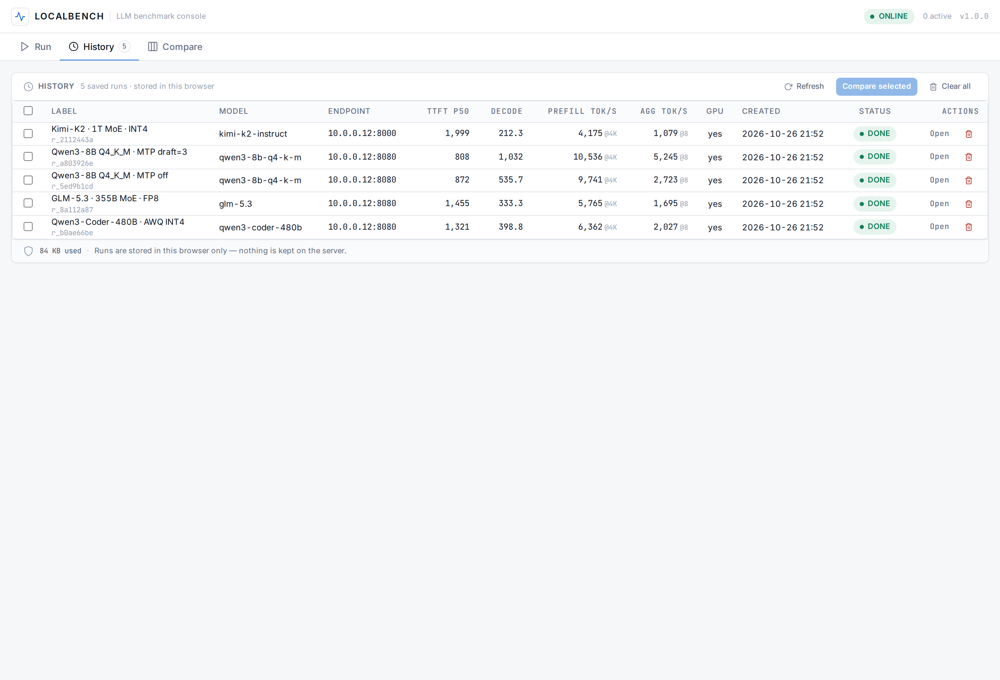
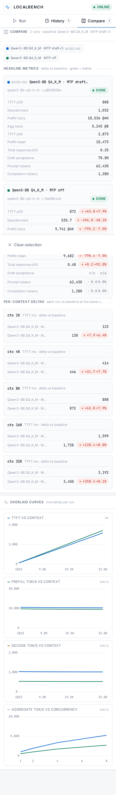
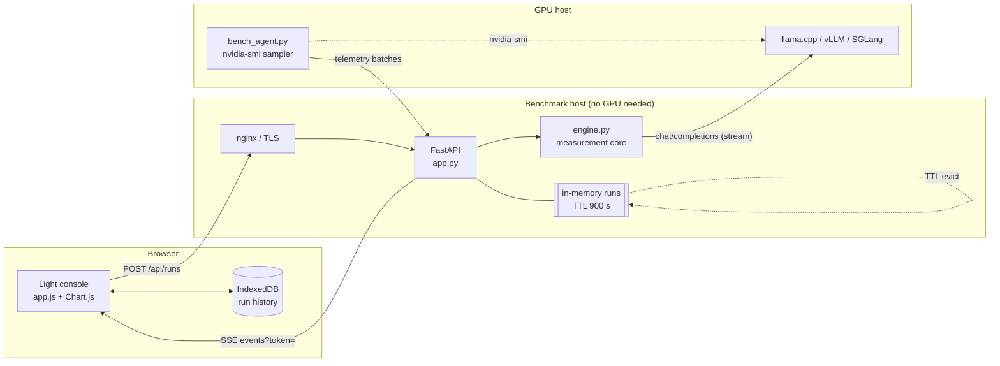
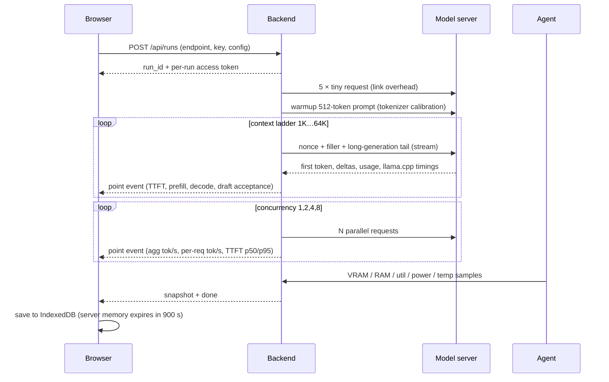

# LocalBench

**A self-hosted benchmark console for local LLM servers.** Paste an OpenAI-compatible
endpoint (`base_url` + key + model) → one click → TTFT, decode/prefill speed across a
1K–64K context ladder, batch scaling, GPU telemetry and draft-acceptance stats, saved in
your browser so you can compare MTP / speculative-decoding configurations side by side.

```
Browser (light console)  ──SSE──►  FastAPI backend  ──HTTP──►  llama.cpp / vLLM / SGLang / LM Studio / Ollama
        │                              ▲
        │  IndexedDB (history)         └──── telemetry agent (nvidia-smi) on the GPU host
        └── nothing stored on the server
```



## Why

Tuning a local inference server is a guessing game: every `--draft-max`, `--draft-min`,
quantisation or `-np` value changes TTFT, prefill and decode speed, and a spreadsheet of
`time curl` runs tells you almost nothing. LocalBench runs the whole matrix in one click,
measures it the same way every time, and keeps the runs you want to A/B.

It is built for **MTP / speculative decoding** work: llama.cpp's `timings` block is read
straight out of the response, so `draft_n`, `draft_n_accepted` and the acceptance rate land
next to decode tok/s — the number that actually decides whether a draft model is worth it.

## What one run measures

| Metric | How it is measured |
|---|---|
| **TTFT** | request sent → first streamed content delta, raw and minus measured link overhead |
| **Decode tok/s** | `(completion_tokens − 1) / (t_last_token − t_first_token)`; `n/a` under 8 tokens instead of a fake 0 |
| **Prefill tok/s** | 1K / 4K / 8K / 16K / 32K / 64K ladder; server-side `timings.prompt_per_second` when available, otherwise TTFT-derived with a link-latency correction |
| **Prompt processing time** | corrected TTFT per context rung, with a per-request cache-busting nonce so a prefix cache cannot fake it |
| **Total response time** | wall clock from request to stream end, per rung |
| **Batch / concurrency** | N parallel requests at a fixed context → aggregate tok/s, per-request tok/s, TTFT p50/p95 |
| **Draft acceptance (MTP)** | `timings.draft_n` / `draft_n_accepted` → acceptance rate per rung |
| **Model load time** | optional: the agent restarts the server and times readiness |
| **VRAM idle / peak / avg** | telemetry agent (`nvidia-smi`) samples during the run, bucketed by phase |
| **RAM, GPU util, power, temperature** | same agent, live sparkline in the dashboard |
| **Tokenizer calibration** | warmup request calibrates chars/token so each rung really is 1K/4K/8K… tokens |

Repeats, warmup requests, context ladder, concurrency ladder, `max_tokens` and per-run
timeouts are all configurable per run.

## Screenshots

| Run (large model) | Compare (MTP off vs draft=3) |
|---|---|
|  |  |

| History | Mobile |
|---|---|
|  |  |

> The screenshots above are produced by the bundled deterministic demo (`mock/mock_openai.py`
> + `scripts/demo_capture.py`, then seeded into the UI by `scripts/demo_screens.py`) so they
> can be reproduced without a GPU. They illustrate the UI and the *shape* of a real result
> set, not a hardware claim.

## Quick start

Requirements: **Python 3.12+**, no GPU needed on the dashboard host (the GPU lives behind the
endpoint you benchmark). A small VM or SBC is enough.

```bash
git clone https://github.com/horizonbymuneeb/localbench.git
cd localbench
python3 -m venv .venv
.venv/bin/pip install -r backend/requirements.txt
.venv/bin/python -m uvicorn backend.app:app --host 127.0.0.1 --port 21700
```

Open <http://127.0.0.1:21700>, paste your endpoint (e.g. `http://192.168.1.50:8080/v1`,
model `qwen3-8b-q4-k-m`, key can be `none` for llama.cpp) and hit **Run benchmark**.

Environment variables:

| Variable | Default | Meaning |
|---|---|---|
| `LOCALBENCH_MAX_RUNS` | `2` | concurrent runs; the rest queue FIFO |
| `LOCALBENCH_TTL_S` | `900` | how long a finished run stays in server memory (browser copy is permanent) |
| `LOCALBENCH_RATE_LIMIT` | `6/600` | runs per IP per window; `0/600` disables; loopback is exempt |
| `LOCALBENCH_PRESETS` | `data/presets.json` | server-side endpoint presets (see below) |
| `LOCALBENCH_DATA_DIR` | `data` | where `presets.json` lives (nothing else is written) |
| `LOCALBENCH_PERSIST` | `0` | `1` = debug-only sqlite store (tests use it) |

## GPU telemetry agent

An HTTP endpoint cannot report VRAM, power or temperature — run the one-file agent on the
machine that hosts the model, while the run is in progress. The dashboard shows the exact
command with the run's key; it is also:

```bash
curl -sO http://<dashboard-host>:21700/bench_agent.py
python3 bench_agent.py --server http://<dashboard-host>:21700 --run r_xxxxxxxx --key ak_xxxx
```

It samples `nvidia-smi` and `free -m` every 250 ms, batches POSTs, and stops when the run
finishes. Add model-load timing with:

```bash
python3 bench_agent.py --server http://<dashboard-host>:21700 --run r_xxxxxxxx --key ak_xxxx \
  --restart-cmd "systemctl --user restart llama-server" \
  --ready-url http://127.0.0.1:8080/v1/models
```

No agent connected → the GPU tiles say `n/a`. Nothing is ever estimated.

## Finding the best MTP / speculative-decoding setup

1. Fix model + quantisation, run a baseline, label it `mtp off`.
2. Change one server flag (`--draft-model`, `--draft-max`, `--draft-min`, `--draft-p-min`,
   `-np`, batch size…), restart, run again with a new label.
3. Repeat for the candidates you care about.
4. **Compare** tab: select the runs → per-metric delta table against the baseline,
   per-context deltas, overlay charts for TTFT / prefill / decode / aggregate throughput.
5. Export JSON/CSV (generated from the browser copy) for notes or a PR.



## Architecture



### Measurement flow of one run



## Privacy model

- **The server stores no benchmark data.** Runs live in RAM while they execute plus a 900 s
  TTL so a reloaded tab can still read them; after that they are gone. No database, no
  export files, no endpoint/label/key in logs (nginx logs the path only — SSE tokens travel
  as `?token=` and are excluded from the log format).
- **History, compare and exports live in your browser** (IndexedDB). `Clear history` deletes
  them; clearing site data deletes everything.
- **API keys are never persisted or returned.** They are used in memory for the run only.
- **Per-run access token** (`X-Run-Token`, `?token=` for SSE): one visitor cannot read
  another visitor's run, and a missing/wrong token is indistinguishable from an unknown run.
- **SSRF guard** on user-supplied URLs (http/https only; loopback, link-local and cloud
  metadata addresses rejected) plus a per-IP rate limit on run creation.

## Shared endpoints (server-managed credentials)

`data/presets.json` can hold endpoints whose key never leaves the server, so visitors can
benchmark a shared rig without pasting anything:

```json
[
  {
    "id": "rig-5090",
    "name": "Studio rig · llama.cpp MTP",
    "base_url": "http://10.0.0.12:8080/v1",
    "model": "qwen3-8b-q4-k-m",
    "note": "32 GB GPU, draft-max 3",
    "api_key": "<server-side key>"
  }
]
```

`GET /api/presets` returns `id/name/base_url/model/note/has_credential` — never the key.
The UI then sends `{preset_id, label, config}` and the backend injects the credential.
Keep the file `chmod 600`.

## Production deploy

`deploy/` contains everything used in practice:

```bash
sudo bash deploy/deploy.sh          # nginx vhost + TLS + systemd unit + health check (idempotent)
```

- `deploy/localbench.service` — systemd unit (`Restart=always`, hardened with
  `NoNewPrivileges`, `ProtectSystem`, `ReadWritePaths` limited to `data/`)
- `deploy/localbench.nginx.conf` — TLS vhost; **SSE needs** `proxy_buffering off`, `gzip off`,
  long `proxy_read_timeout`, and `/api/runs` matched before the generic location
- `deploy/localbench-headers.conf` — CSP (`default-src 'self'`), HSTS, no-cache assets
- `deploy/localbench-log.conf` — log format without query strings (SSE tokens)
- `deploy/deploy.sh` — certbot webroot issuance/renewal, health check

The dashboard is small: 2 vCPU / 2 GB is plenty for a handful of concurrent benchmarks.
Point `base_url` at the GPU host; the dashboard itself never touches the GPU.

## HTTP API

| Endpoint | Purpose |
|---|---|
| `POST /api/discover` | fetch `/v1/models` through the server (no CORS in the browser) |
| `POST /api/runs` | create a run (explicit endpoint or `preset_id`) → `run_id` + `access_token` |
| `GET /api/runs/{id}/events?token=` | SSE: `snapshot`, `progress`, `point`, `telemetry`, `done` |
| `GET /api/runs/{id}` | full run JSON (token required) |
| `POST /api/runs/{id}/cancel`, `DELETE /api/runs/{id}` | cancel / drop a run |
| `POST /api/runs/{id}/telemetry` | agent ingest (`X-Agent-Key`) |
| `GET /api/runs/{id}/agent` | agent command for this run (token required) |
| `GET /api/runs/{id}/export?format=json\|csv` | server-side export while in memory |
| `GET /api/presets`, `GET /api/config`, `GET /api/stats`, `GET /healthz` | metadata / counters |

Full schema and measurement definitions: [`CONTRACT.md`](CONTRACT.md).

## Tests

```bash
.venv/bin/python -m pytest tests/ -q
# 108 passed
```

The suite is hermetic (mock OpenAI server, ephemeral ports, tmp data dirs) and covers the
measurement maths, context-overflow handling, concurrency aggregation, SSRF guard, run
lifecycle, per-run token isolation, memory-only storage + TTL eviction, SSE replay, agent
telemetry aggregation, CSV export and a real-process end-to-end run. There is also a
browser smoke/IndexedDB check (`tests/ui_smoke.py`) and maintainer scripts in `scripts/`.

A bundled deterministic mock lets you develop without a GPU:

```bash
.venv/bin/python mock/mock_openai.py --port 8099 --ttft-ms 60 --tps 900 --prefill-tps 12000 \
  --ctx 131072 --draft-n 96 --draft-accepted 68
```

## Hardware used for the screenshots

| Piece | Reference |
|---|---|
| Benchmark target (GPU) | single 32 GB-class NVIDIA GPU (RTX 5090 class) — demo fixture numbers |
| Serving stacks | llama.cpp (MTP / speculative decoding), vLLM |
| Dashboard host | any x86_64/arm64 Linux with Python 3.12, 1 vCPU / 512 MB RAM minimum, no GPU |

## Layout

```
backend/   FastAPI app, measurement engine, memory store, agent helpers
agent/     bench_agent.py — nvidia-smi / RAM sampler + model-load timing
web/       light console (vanilla ES modules, self-hosted Inter + JetBrains Mono, inline SVG sprite)
mock/      deterministic OpenAI-compatible mock (SSE, usage, llama.cpp timings, 400 on overflow)
tests/     pytest suite (+ CDP browser smoke)
deploy/    systemd unit, nginx vhost, security headers, log format, deploy script
docs/      screenshots + demo run fixtures
scripts/   maintainer capture/verification scripts
```

## License

MIT — see [LICENSE](LICENSE).
